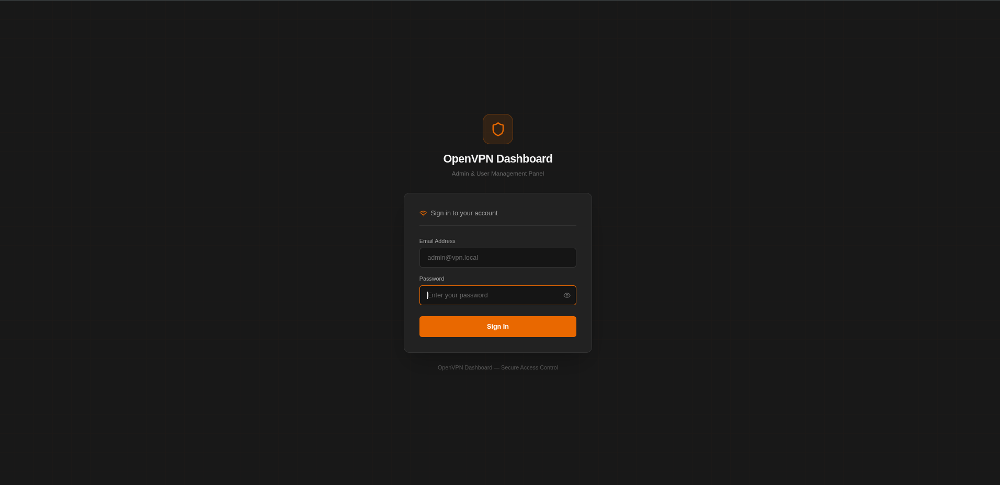
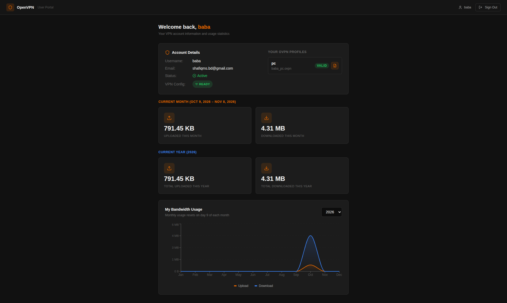
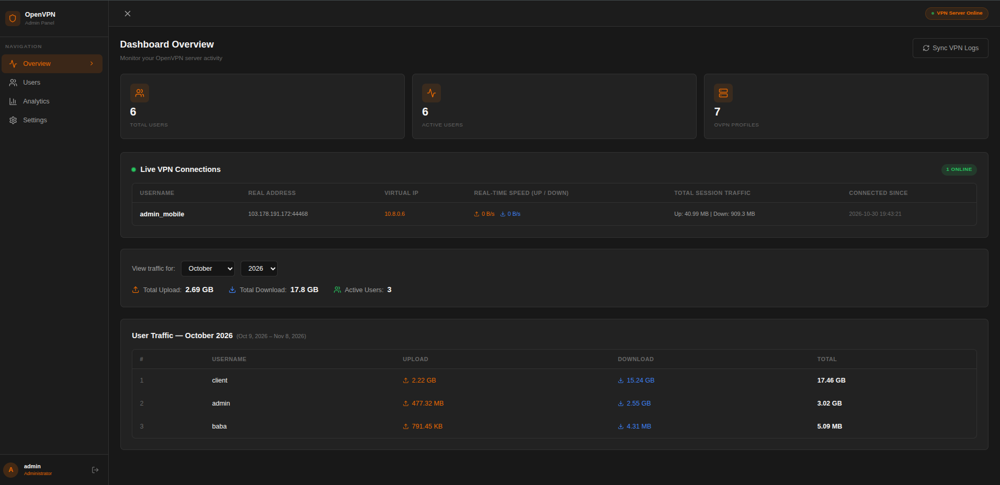
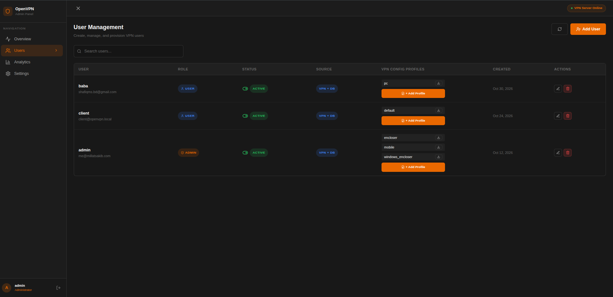
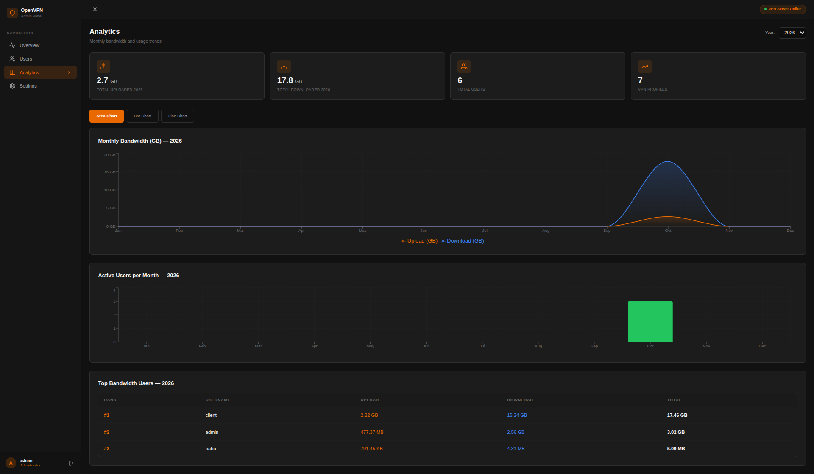
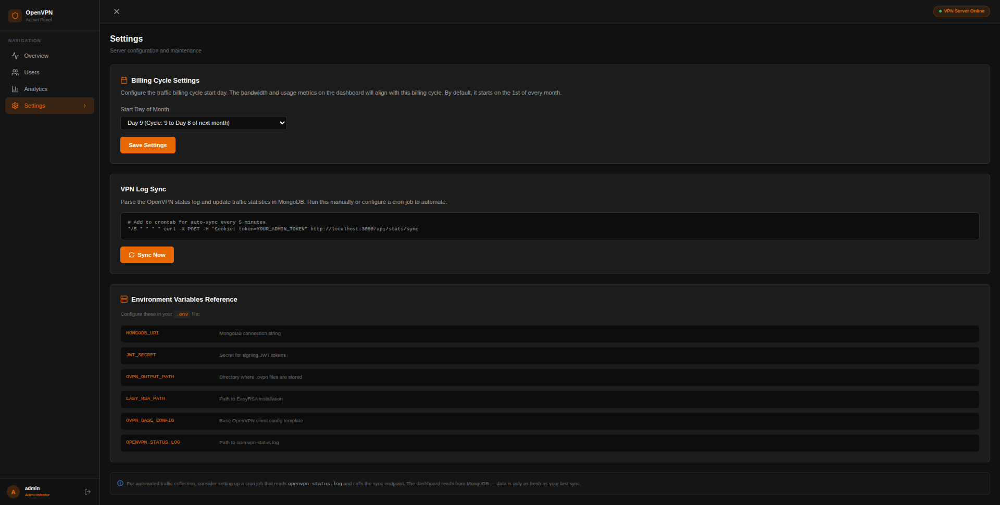

<div align="center">

# 🌐 OpenVPN Dashboard

**A modern, production-ready admin panel, client portal, and real-time monitoring dashboard for OpenVPN servers.**

Built with Next.js 14, MongoDB, Tailwind CSS, and Socket.IO.

---

[](https://nextjs.org/)
[](https://www.typescriptlang.org/)
[](https://mongoosejs.com/)
[](https://tailwindcss.com/)
[](https://socket.io/)
[](LICENSE.txt)

<br/>

[Key Features](#-key-features) • [Screenshots](#-screenshots) • [Tech Stack](#-tech-stack) • [Quick Start](#-quick-start) • [Environment Variables](#-environment-variables) • [OpenVPN Setup](#-openvpn-server-configuration) • [API Reference](#-api-routes) • [Production Deployment](#-production-deployment) • [License](#-license)

</div>

---

## 📸 Screenshots

### 1. 🔐 Login Page


### 2. 👤 User Portal


### 3. 🖥️ Admin Overview Dashboard


### 4. 👥 User Management


### 5. 📊 Bandwidth Analytics


### 6. ⚙️ System Settings


---

## ✨ Key Features

### 🛠️ Admin Panel
- **User Management** — Create, enable/disable, and delete VPN users with instant status updates.
- **Automated `.ovpn` Generation** — Generate and download complete `.ovpn` client configuration profiles integrated with EasyRSA PKI.
- **Real-Time Traffic Monitoring** — Live upload/download metrics, active sessions, real IP, and virtual IP tracking via WebSocket (Socket.IO).
- **Interactive Analytics** — Bar, Area, and Line charts powered by Recharts for monthly and yearly bandwidth trends.
- **Top Users Leaderboard** — Identify heavy users and monitor bandwidth distribution across your network.
- **Certificate Revocation** — Automatically revokes client certificates in EasyRSA upon user deletion for airtight security.
- **Status Log Syncing** — Automatically parses OpenVPN status logs and syncs client metrics into MongoDB.

### 👤 Self-Service User Portal
- **Account Status Overview** — Users can verify account validity, active connection status, and IP assignment.
- **Profile Download** — Direct download for generated `.ovpn` configuration profiles.
- **Bandwidth Consumption Chart** — Dedicated user-facing usage breakdown per month.

---

## 🛠️ Tech Stack

| Component | Technology | Description |
| :--- | :--- | :--- |
| **Frontend** | [Next.js 14](https://nextjs.org/) (App Router), [React 18](https://react.dev/) | Modern hybrid server/client component architecture |
| **Styling** | [Tailwind CSS](https://tailwindcss.com/), [Lucide React](https://lucide.dev/) | Utility-first responsive design with dark mode styling |
| **Charts** | [Recharts](https://recharts.org/) | Composable, interactive SVG visualization library |
| **Real-time** | [Socket.IO](https://socket.io/) | Low-latency bi-directional event stream for live stats |
| **Backend & API** | Node.js Custom Server (`server.js`) + Next.js Route Handlers | Unified HTTP server with integrated WebSocket & API routes |
| **Database** | [MongoDB](https://www.mongodb.com/) via [Mongoose](https://mongoosejs.com/) | Document database for accounts, traffic logs, and sessions |
| **Security** | JWT (`jsonwebtoken`), bcryptjs, HTTP-only Cookies | Secure token authentication & salted password hashing |
| **VPN Integration** | OpenVPN Server & [Easy-RSA 3](https://github.com/OpenVPN/easy-rsa) | PKI management, client certificates, status log parser |

---

## 🚀 Quick Start

### 1. Prerequisites
Ensure you have the following installed:
- **Node.js** (v18.x or v20.x recommended)
- **MongoDB** (v5.x or higher running locally or MongoDB Atlas)
- **OpenVPN** and **Easy-RSA** configured on your Linux host

### 2. Clone and Install Dependencies

```bash
git clone https://github.com/MillatSakib/OpenVPN-Dashboard.git
cd OpenVPN-Dashboard
npm install
```

### 3. Configure Environment Variables

Copy the example configuration:

```bash
cp .env.example .env
```

Open `.env` and fill in your server paths and credentials:

```env
# MongoDB Connection
MONGODB_URI=mongodb://localhost:27017/openvpn-dashboard

# JWT Secret (Generate a strong random string)
JWT_SECRET=your-super-secret-jwt-key-here

# OpenVPN & EasyRSA Paths
OVPN_OUTPUT_PATH=/root
OVPN_BASE_CONFIG=/etc/openvpn/server/client-common.txt
EASY_RSA_PATH=/etc/openvpn/server/easy-rsa
OPENVPN_STATUS_LOG=/run/openvpn-server/status-server.log

# NextAuth / App URL
NEXTAUTH_SECRET=your-nextauth-secret
NEXTAUTH_URL=http://localhost:3000

# Default Admin Credentials (Used for initial seed)
ADMIN_DEFAULT_EMAIL=admin@vpn.local
ADMIN_DEFAULT_PASSWORD=Admin@1234
```

### 4. Seed the Initial Admin Account

Run the database seed script to initialize your admin user:

```bash
npm run seed
```

### 5. Launch the Development Server

Start the custom Node server (includes Next.js + Socket.IO):

```bash
npm run dev
```

Visit [http://localhost:3000](http://localhost:3000) and log in with your configured admin credentials.

---

## ⚙️ Environment Variables

| Variable | Required | Default | Description |
| :--- | :---: | :--- | :--- |
| `MONGODB_URI` | Yes | `mongodb://localhost:27017/openvpn-dashboard` | MongoDB connection connection string |
| `JWT_SECRET` | Yes | — | Secret key used to sign and verify JWT authentication tokens |
| `OVPN_OUTPUT_PATH` | Yes | `/root` | Directory where generated client `.ovpn` files are saved |
| `OVPN_BASE_CONFIG` | Yes | `/etc/openvpn/server/client-common.txt` | Base client configuration template |
| `EASY_RSA_PATH` | Yes | `/etc/openvpn/server/easy-rsa` | Path to EasyRSA installation directory |
| `OPENVPN_STATUS_LOG` | Yes | `/run/openvpn-server/status-server.log` | Path to OpenVPN status log file |
| `ADMIN_DEFAULT_EMAIL` | Yes | `admin@vpn.local` | Email for initial admin account creation |
| `ADMIN_DEFAULT_PASSWORD` | Yes | `Admin@1234` | Password for initial admin account |
| `NEXTAUTH_URL` | No | `http://localhost:3000` | Canonical URL of the application |
| `PORT` | No | `3000` | HTTP port for the application server |

---

## 🔒 OpenVPN Server Configuration

For `.ovpn` generation and status tracking to function properly:

1. **Easy-RSA PKI**: Must be initialized at `EASY_RSA_PATH` with a valid CA.
2. **File Permissions**: The Node.js process user needs read permissions on `OPENVPN_STATUS_LOG` and execute/write permissions for EasyRSA operations.
3. **Client Template (`client-common.txt`)**: Contains remote server IP, port, and cipher settings.

### Sample `client-common.txt`

```ini
client
dev tun
proto udp
remote YOUR_SERVER_IP 1194
resolv-retry infinite
nobind
persist-key
persist-tun
remote-cert-tls server
auth SHA256
cipher AES-256-CBC
verb 3
```

### Optional: Traffic Sync via Cron
While `server.js` parses the status log in real time, you can also trigger a periodic sync via crontab:

```bash
*/5 * * * * curl -s -X POST -H "Cookie: token=ADMIN_JWT_TOKEN" http://localhost:3000/api/stats/sync > /dev/null 2>&1
```

---

## 📁 Project Structure

```
.
├── scripts/
│   └── seed.ts                  # Database seeding script for admin account
├── server.js                    # Custom HTTP + Socket.IO server entrypoint
├── src/
│   ├── app/
│   │   ├── admin/               # Admin pages (overview, users, analytics, settings)
│   │   ├── dashboard/           # Self-service user portal
│   │   ├── login/               # Authentication page
│   │   └── api/
│   │       ├── auth/            # /login, /logout, /me
│   │       ├── users/           # User CRUD endpoints
│   │       ├── ovpn/            # .ovpn generation & download endpoints
│   │       └── stats/           # Bandwidth analytics, traffic, and log sync
│   ├── assets/                  # UI screenshots & preview images
│   ├── lib/
│   │   ├── auth.ts              # JWT verify/sign helpers
│   │   ├── mongodb.ts           # Mongoose connection pool
│   │   └── utils.ts             # Data formatters (bytes, dates)
│   └── models/
│       ├── User.ts              # User account schema & roles
│       ├── TrafficLog.ts        # Monthly & yearly traffic logs
│       └── ConnectionLog.ts     # Client session history
├── .env.example                 # Example environment variables
├── package.json                 # Project dependencies & scripts
├── tailwind.config.js           # Tailwind CSS theme configuration
└── tsconfig.json                # TypeScript compiler configuration
```

---

## 🔌 API Routes

| Method | Endpoint | Authorization | Description |
| :---: | :--- | :---: | :--- |
| `POST` | `/api/auth/login` | Public | Authenticate user and issue JWT cookie |
| `POST` | `/api/auth/logout` | Any | Clear session cookie |
| `GET` | `/api/auth/me` | Any | Retrieve current authenticated user profile |
| `GET` | `/api/users` | Admin | Retrieve paginated list of all VPN users |
| `POST` | `/api/users` | Admin | Create a new VPN user |
| `PATCH` | `/api/users/:id` | Admin | Update user details or toggle active status |
| `DELETE` | `/api/users/:id` | Admin | Revoke certificate and remove user |
| `POST` | `/api/ovpn/generate/:id` | Admin | Generate `.ovpn` configuration using EasyRSA |
| `GET` | `/api/ovpn/generate/:id` | Admin / Owner | Download client `.ovpn` profile |
| `GET` | `/api/stats` | Admin | Fetch monthly aggregated upload/download stats |
| `GET` | `/api/stats/analytics` | Admin | Fetch yearly analytics and bandwidth distributions |
| `POST` | `/api/stats/sync` | Admin | Trigger manual sync from OpenVPN status log |
| `GET` | `/api/stats/my` | User | Retrieve current user's bandwidth history |

---

## 🚢 Production Deployment

### 1. Build and Run

```bash
# Build Next.js application
npm run build

# Start production server
npm start
```

### 2. Process Management with PM2

Keep the server running in the background and auto-restart on system boot:

```bash
sudo npm install -g pm2
pm2 start npm --name "openvpn-dashboard" -- start
pm2 save
pm2 startup
```

### 3. Nginx Reverse Proxy Configuration

Create an Nginx configuration file (e.g., `/etc/nginx/sites-available/openvpn-dashboard`):

```nginx
server {
    listen 80;
    server_name vpn.yourdomain.com;

    location / {
        proxy_pass http://127.0.0.1:3000;
        proxy_http_version 1.1;

        # WebSocket support (Socket.IO)
        proxy_set_header Upgrade $http_upgrade;
        proxy_set_header Connection "upgrade";

        proxy_set_header Host $host;
        proxy_set_header X-Real-IP $remote_addr;
        proxy_set_header X-Forwarded-For $proxy_add_x_forwarded_for;
        proxy_set_header X-Forwarded-Proto $scheme;
        proxy_cache_bypass $http_upgrade;
    }
}
```

Enable SSL via Certbot:

```bash
sudo certbot --nginx -d vpn.yourdomain.com
```

---

## 🎨 Brand & Color Theme

Designed to match OpenVPN's official branding palette:
- **OpenVPN Orange**: `#EA6800` — Primary action buttons, badges, highlights
- **Dark Obsidian**: `#111111` — Sleek modern dark theme background
- **Soft White**: `#F5F5F5` — High-contrast typography

---

## 📄 License

This project is licensed under the **MIT License** — see the [LICENSE.txt](LICENSE.txt) file for details.

Developed with ❤️ by [MD. SOHAN MILLAT SAKIB](https://github.com/MillatSakib).
